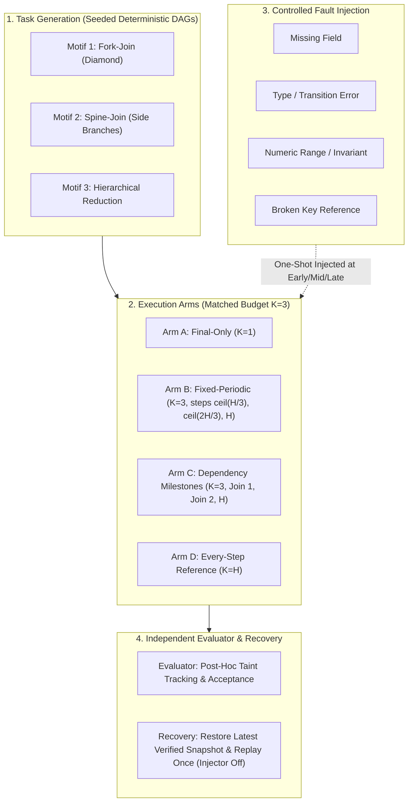

# Phase D.1 — Final Experimental Design Review Before Implementation

**Date:** 2026-11-04  
**Author / Reviewer:** AI Research Mentor & Research Software Engineer  
**Researcher / Decision-Maker:** Harsh Sharma  
**Research Direction:** G4 — Intermediate Deterministic Verification Scheduling  
**Document Status:** PENDING HUMAN REVIEW AND DECISION (GATE 1 REVIEW)  
**Governing Rule:** `AGENTS.md` (Implementation-Based Research Assignment, IIIT Allahabad)

---

## 1. Executive Summary and Scope

Following the selection of research direction **G4 (Intermediate Deterministic Verification)** in Phase D, this document presents the final scientific and methodological consistency review of the experimental design prior to any implementation in Phase E. 

The purpose of this review is not to alter the approved research direction or restart the formulation process, but to audit the candidate protocol against rigorous empirical standards: eliminating internal mathematical or topological contradictions, establishing unambiguous operational definitions for metrics and fault coverage, aligning hypotheses with formal statistical tests, clarifying recovery and budget mechanics, and strictly delineating the scientific claims supported by deterministic execution.

Every identified issue is classified by severity:
- **BLOCKER:** A structural or logical contradiction that prevents valid implementation or comparison.
- **MAJOR:** A methodological, statistical, or definitional ambiguity that threatens validity if uncorrected.
- **MINOR:** A precision, reporting, or budget clarification needed for strict reproducibility and fairness.

No Python code has been written, no dependencies installed, no experiments executed, and no protocol frozen. Implementation begins only upon the researcher's explicit approval of the recommendations herein.

---

## 2. Detailed Technical Audit of Candidate Issues

### Issue A: DAG Task Design and Milestone Integration Boundaries
- **Severity:** **BLOCKER**
- **Existing Protocol State:** `experiment_protocol.md` (§2, §3) proposes three topology motifs: (1) linear chain, (2) fan-out/fan-in join, and (3) mixed chain + joins. For Condition C (Dependency Milestones), the schedule allocates checks at two internal graph-derived integration boundaries plus the terminal check.
- **Identified Defect:** A pure linear chain ($v_1 \to v_2 \to \dots \to v_H$) contains strictly in-degree 1 and out-degree 1 for all internal nodes. It possesses **zero** multi-parent dependency-integration boundaries (joins). Consequently:
  1. The milestone derivation rule ("completion of declared join inputs before downstream join/use") fails on linear chains, leaving 0 milestones and violating the 3-slot budget parity with Condition B.
  2. Any fallback rule applied to chains (e.g., placing checks at arbitrary cut points or fixed steps) would either silently emulate periodic placement or introduce an ad-hoc rule with no structural integration meaning, destroying construct validity.
- **Recommended Correction (Option 1):** Replace the pure linear chain with three distinct topology motifs that all inherently feature multi-parent dependency integration boundaries while varying structural complexity:
  1. **Two-Stage Diamond / Fork-Join Motif:** Two sequential fan-out/fan-in subgraphs connected in series. The two internal integration milestones are placed precisely at the completion of all branch inputs preceding each fan-in join node.
  2. **Pipeline with Multi-Parent Side-Branches (Spine-Join Motif):** A main transformation spine where two separate parallel processing branches compute side-artifacts that merge into the spine at two distinct join nodes. Milestones occur upon the completion of all inputs to each respective join node.
  3. **Hierarchical Reduction Tree Motif:** A multi-source tree converging through two distinct synchronization layers (e.g., 4 parallel inputs $\to$ 2 intermediate aggregates $\to$ terminal artifact). Milestones occur at the synchronization points preceding each reduction layer.
- **Scientific Justification:** The theoretical rationale for dependency-milestone verification is that intermediate checks prevent corrupted intermediate outputs from polluting downstream integrations. Testing this mechanism on graphs devoid of integrations is fundamentally uninformative. Guaranteeing exactly two well-defined integration boundaries across all three motifs ensures Condition C evaluates a structurally consistent, non-oracular scheduling rule with an identical 3-slot budget on every instance.

---

### Issue B: Primary Metric (Downstream Taint-Consumption Fraction)
- **Severity:** **MAJOR**
- **Existing Protocol State:** `hypotheses_and_metrics.md` (§Operational definitions) defines:
  $$\text{TCF}_e = \frac{C_e}{\max(1, |\text{Desc}_g(j)|)}$$
  where $C_e$ is the number of distinct downstream nodes that consume a tainted artifact before execution halts or finishes, and $\text{Desc}_g(j)$ is the set of topological descendants of injection node $j$.
- **Identified Defect:** 
  1. *Sink/Terminal Node Edge Case:* When a fault is injected at a terminal node or a dead-end branch node with no descendants ($|\text{Desc}_g(j)| = 0$), the formula evaluates to $0 / 1 = 0$. This artificially reports a "perfect" $0\%$ taint consumption, not because verification caught the error, but because no descendants existed to consume it. This corrupts the metric.
  2. *Lineage Tracking Separation:* If the verifier or executor had access to taint lineage during execution, it would constitute an oracular cheat.
- **Recommended Correction:**
  1. **Strict Eligibility Filter:** Formally restrict the primary metric evaluation to *eligible fault episodes* where $|\text{Desc}_g(j)| \ge 1$:
     $$\text{TCF}_e = \frac{C_e}{|\text{Desc}_g(j)|}, \quad \text{for } e \in E_{\text{eligible}} = \{e : |\text{Desc}_g(j)| \ge 1\}$$
  2. **Separate Reporting:** Fault episodes injected at terminal/sink nodes ($|\text{Desc}_g(j)| = 0$) are excluded from the primary $\text{TCF}$ estimand and reported in a separate descriptive category ("Terminal Fault Detection Subset", evaluated only on fault detection coverage and task completion).
  3. **Evaluator Isolation:** Taint propagation is computed post hoc or via an independent evaluator sidecar that inspects node input/output hashes and dependency edges. The verifier receives strictly the public task specification, node contracts, and current execution state. Taint labels and injection seeds are never exposed to verifier logic.
  4. **Hierarchical Paired Aggregation:**
     $$\Delta \text{TCF}_e = \text{TCF}_C(e) - \text{TCF}_B(e)$$
     Within-graph mean difference:
     $$\overline{\Delta \text{TCF}}_g = \frac{1}{|E_{g,\text{eligible}}|} \sum_{e \in E_{g,\text{eligible}}} \Delta \text{TCF}_e$$
     Global mean paired effect across $N_g$ graphs:
     $$\overline{\Delta \text{TCF}} = \frac{1}{N_g} \sum_{g=1}^{N_g} \overline{\Delta \text{TCF}}_g$$
- **Scientific Justification:** Eliminating zero-descendant episodes prevents artificial score dilution. Clustered aggregation at the graph level accounts for intra-graph correlation among different fault scenarios sharing the same DAG topology.

---

### Issue C: Consistency Between Hypotheses and Statistical Testing
- **Severity:** **MAJOR**
- **Existing Protocol State:** 
  - Hypothesis H1 is framed directionally: "dependency-boundary checks produce a lower mean downstream taint-consumption fraction than fixed-periodic checks ($\mu_C < \mu_B$)".
  - The null hypothesis H0 is framed as zero difference: "paired mean difference is zero ($\mu_{C-B} = 0$)".
  - The statistical plan proposes a two-sided test at $\alpha = 0.05$.
- **Identified Defect:** A directional research hypothesis ($H_1: \mu_{C-B} < 0$) coupled with a two-sided null hypothesis ($H_0: \mu_{C-B} = 0$) and a two-sided test creates a formal inconsistency: a statistically significant rejection in the wrong direction ($\mu_{C-B} > 0$, meaning periodic verification was significantly better) would formally reject $H_0$ but falsify the researcher's directional expectation.
- **Recommended Correction (Option 1 — Recommended):**
  - Formulate the primary statistical hypothesis as a rigorous **two-sided test**:
    - **Null Hypothesis ($H_0$):** The mean paired graph-level difference in downstream taint-consumption fraction between dependency-milestone and fixed-periodic verification is zero ($\mu_{\Delta} = \mu_{C-B} = 0$).
    - **Alternative Hypothesis ($H_1$):** The mean paired graph-level difference is non-zero ($\mu_{\Delta} = \mu_{C-B} \ne 0$).
  - **Test Procedure:** Nonparametric paired permutation test on graph-level means ($\overline{\Delta \text{TCF}}_g$), accompanied by a 95% two-sided BCa (bias-corrected and accelerated) or percentile bootstrap confidence interval clustered by graph.
  - **Directional Interpretation:** If $H_0$ is rejected at two-sided $\alpha = 0.05$, the sign of the point estimate and confidence interval bounds determines whether dependency milestones significantly reduce ($\mu_{\Delta} < 0$) or increase ($\mu_{\Delta} > 0$) taint consumption.
- **Scientific Justification:** Two-sided testing is the conservative gold standard in experimental computer science and empirical software engineering. It acknowledges the legitimate empirical possibility that fixed-periodic checks could outperform milestones (e.g., if milestones cluster late in execution, leaving early branches vulnerable). Adopting a two-sided test prevents bias while fully supporting the research goal.

---

### Issue D: Fault Detection Coverage Dual Denominators
- **Severity:** **MINOR**
- **Existing Protocol State:** `hypotheses_and_metrics.md` mentions reporting detection coverage over all faults and a subset violating contracts, but lacks separate explicit formulas.
- **Identified Defect:** A verifier can only catch a fault if that fault violates an executable assertion in its contract catalog (e.g., schema validation, range assertion, reference integrity). If a synthetic fault alters data in a manner permitted by the public contract (semantic drift), the verifier cannot detect it regardless of scheduling. Conflating these two cases obscures whether missed detections are caused by *scheduling delay* or *verifier contract incompleteness*.
- **Recommended Correction:** Define two mutually exclusive and explicit coverage metrics:
  1. **All-Fault Detection Coverage ($\text{FDC}_{\text{all}}$):**
     $$\text{FDC}_{\text{all}} = \frac{N(\text{fault episodes where verifier halts before completion})}{N(\text{all injected fault episodes})}$$
     *Evaluates end-to-end system containment under the complete fault taxonomy.*
  2. **Contract-Violating Fault Detection Coverage ($\text{FDC}_{\text{contract}}$):**
     $$\text{FDC}_{\text{contract}} = \frac{N(\text{fault episodes where verifier halts before completion})}{N(\text{injected episodes violating } \ge 1 \text{ registered verifier contract})}$$
     *Evaluates the pure scheduling efficiency of the verifier over detectable violations.*
- **Scientific Justification:** Separating these denominators provides transparent accounting. It isolates verifier assertion coverage from scheduling effectiveness, preventing uncheckable faults from penalizing the scheduling comparison.

---

### Issue E: Verification Budget Accounting and Terminology
- **Severity:** **MINOR**
- **Existing Protocol State:** Protocols designate B and C as having "3 check slots", while A has 1 and D has $H$.
- **Identified Defect:** In execution, if an intermediate check fails at slot 1, the workflow immediately halts and rolls back. As a result, slots 2 and 3 are never called. Calling both "3-check conditions" could lead readers to falsely expect exactly 3 realized calls per run. Furthermore, describing conditions A and D without rigorous budget caveats risks invalid cross-arm causal comparisons.
- **Recommended Clarification:**
  1. **Allocated Slots vs. Realized Invocations:**
     - **Allocated Check Budget ($K_{\text{alloc}}$):** The maximum number of scheduled verifier check opportunities available during the original forward pass. For Arm B and Arm C, $K_{\text{alloc}} = 3$ (two intermediate checkpoints + one terminal acceptance checkpoint). For Arm A, $K_{\text{alloc}} = 1$. For Arm D, $K_{\text{alloc}} = H$.
     - **Realized Verifier Invocations ($K_{\text{realized}}$):** The actual number of times the verifier is executed during the episode. When early detection occurs at intermediate slot 1, $K_{\text{realized}} = 1 \le K_{\text{alloc}}$.
     - The experimental comparison between B and C is **fair because their allocated check budgets are strictly identical ($K_{\text{alloc}} = 3$)** and their assertion suites are identical.
  2. **Reference Arm Delineation:** Arms A (terminal-only, $K_{\text{alloc}} = 1$) and D (every-step, $K_{\text{alloc}} = H$) are strictly designated as **unmatched reference anchors** representing minimal and maximal verification frequency. No direct budget-efficiency claims comparing C to A or D will be made without explicitly reporting the call disparity.
- **Scientific Justification:** Maintains strict experimental integrity and budget transparency as required by `AGENTS.md` §10.

---

### Issue F: Recovery Policy (Restore-and-Replay-Once Mechanics)
- **Severity:** **MAJOR**
- **Existing Protocol State:** Protocol proposes "restore and replay once", saving snapshots at each node boundary.
- **Identified Defect:** Ambiguity exists regarding: (1) what makes a snapshot "verified" and eligible for restoration, (2) how rollback distance is formally computed, (3) whether replay behaves identically across all four arms, and (4) how replay impacts metrics.
- **Recommended Clarification and Specification:**
  1. **Verified Snapshot Rule:**
     - A snapshot of the workflow state is recorded after every completed node execution ($k = 1, \dots, H$). The initial clean input state is snapshot $k = 0$ and is verified by definition.
     - A snapshot $k$ becomes an **eligible restoration checkpoint** if and only if a scheduled verifier check is executed at node $k$ and **passes all registered contracts**.
     - If a scheduled check fails at node $t$, the execution halts immediately. The engine rolls back to the **most recent verified checkpoint** $s$ ($s < t$). If no intermediate check has passed prior to $t$, the engine rolls back to the initial input state ($s = 0$).
  2. **Rollback Distance:**
     $$\text{RollbackDistance} = t - s$$
     *Measures the exact number of executed node outputs discarded due to fault detection.*
  3. **Replay Uniformity Across All Arms:**
     - Replay resumes from snapshot $s$, executing nodes $s+1 \to H$ in identical topological order using the same deterministic executor.
     - **Transient Fault Model:** The injected fault was a one-shot event during the original pass; the injector is **disarmed during replay** to evaluate whether rollback successfully recovers the workflow.
     - **Zero Replay Checks:** No scheduled verifier checks are executed during replay in *any* arm. Only the independent final acceptance check evaluates the terminal artifact.
  4. **Metric Isolation:**
     - Nodes executed during replay ($H - s$) are logged as $\text{Nodes}_{\text{replay}}$ and included in `Total Workflow Time` and `Replay Work`.
     - Replay nodes are **excluded from the original-pass TCF numerator** $C_e$ (which measures forward taint consumption prior to detection).
- **Scientific Justification:** This policy standardizes recovery across all four arms, isolating scheduling placement as the sole experimental variable while preventing confounding from method-specific automated repair heuristics.

---

### Issue G: Task Count, Sample Size Arithmetic, and Feasibility
- **Severity:** **MINOR**
- **Existing Protocol State:** Proposed sample: 30 final graphs per horizon $\times$ 3 horizons ($H = 12, 24, 36$) = 90 graphs. Each graph has 12 fault variants (4 types $\times$ 3 positions) + 1 clean control = 13 scenarios. Evaluated across 4 arms = 4,680 initial episodes. Plus 30 pilot graphs (5 dev + 5 val per horizon).
- **Arithmetic Verification:**
  - Final scenarios: $90 \times 13 = 1,170$ paired scenarios.
  - Total initial episodes across 4 arms: $1,170 \times 4 = 4,680$ episodes.
  - Forward node executions per arm:
    - Horizon 12: $30 \times 13 \times 12 = 4,680$ node executions.
    - Horizon 24: $30 \times 13 \times 24 = 9,360$ node executions.
    - Horizon 36: $30 \times 13 \times 36 = 14,040$ node executions.
    - Per arm total: $28,080$ node executions.
    - All 4 arms combined: $4 \times 28,080 = 112,320$ node executions (plus replay executions).
  - **Feasibility Assessment:** The arithmetic is exact and verified. For lightweight deterministic in-memory Python operations, 112,320 node executions will execute in minutes on the student machine. However, detailed JSONL event logging and snapshot storage will generate substantial file I/O.
- **Recommended Guardrail:**
  - Maintain this sample size as **provisional**.
  - In Phase E, run a **Pilot Benchmark** on the 30 development/validation graphs to measure empirical execution time per node, snapshot serialization size, and log volume.
  - Do not fabricate or claim a theoretical power calculation. If pilot I/O overhead exceeds storage constraints, the pre-registered fallback is **10 final graphs per horizon** (1,560 episodes total, 37,440 node executions), maintaining identical balance across motifs.
- **Scientific Justification:** Honors `AGENTS.md` §3 and §9 by refusing to treat preliminary estimates as verified performance benchmarks or inventing power calculations without empirical pilot variance data.

---

### Issue H: Deterministic versus LLM Evaluation Scope and Scientific Boundaries
- **Severity:** **MAJOR**
- **Existing Protocol State:** Protocol outlines a deterministic core and an optional LLM extension.
- **Resource Audit:** 
  - Host OS: Windows 10/11. Python: 3.14.6. CPU: 16 logical cores observed.
  - API Budget: **UNKNOWN / $0 verified**.
  - LLM Access / API Keys: **UNKNOWN / NONE provided**.
- **Assessment of Scientific Boundaries:**
  - Executing 4,680 episodes with an LLM executor would require $>112,000$ LLM prompt completions, which is completely infeasible without an enterprise API budget and GPU cluster.
  - More importantly, **deterministic workflow execution models error propagation and verification scheduling in structured computation graphs; it does NOT evaluate LLM planning, natural-language reasoning drift, or agent self-correction.**
- **Recommended Correction:**
  1. **Strictly Scope the Primary Research Study to the Deterministic Core:** The implementation in Phase E/F will focus entirely on the deterministic multi-step workflow engine with exact contract checking, formal taint tracking, and controlled fault injection.
  2. **Truthful Scientific Attribution:** The second research paper will explicitly state that the results characterize *process verification scheduling and taint containment in structured dependency graphs*, serving as an empirical foundation for workflow design, and will *not* claim to demonstrate LLM planning reliability.
  3. **Conditional Exploratory Slice Only:** An LLM extension will remain strictly an optional, qualitative post-hoc demonstration (e.g., 1 graph, 2 faults, B vs C) only if the researcher provides verified API credentials and budget in a subsequent phase.
- **Scientific Justification:** Maintains non-negotiable research integrity (`AGENTS.md` §3), ensuring all claims are grounded strictly in reproducible, empirically verified local execution.

---

## 3. Remaining Unknowns Prior to Phase E Implementation

The following project parameters remain unverified and must be tracked:

| Parameter | Current Status | Impact on Phase E Implementation |
|---|---|---|
| Target Repository Visibility | UNKNOWN | Defaulting to local/private. No student PII or credentials committed. |
| Host Free Disk Space | UNKNOWN | WMI query was denied. Pilot must log bytes written per episode to prevent disk exhaustion. |
| Python Environment / Packaging | VERIFIED (Local: Python 3.14.6) | Standard library implementation preferred (`json`, `dataclasses`, `typing`, `hashlib`, `math`, `random`). No heavy third-party dependencies required. |
| External API Budget | UNKNOWN ($0 confirmed) | Deterministic core requires zero API calls. |
| Exact Assignment Submission Deadline | UNKNOWN | Design prioritizes fast, modular, CPU-efficient execution to fit any academic timeline. |

---

## 4. Final Proposed Experimental Configuration (Pre-Implementation Baseline)

Subject to the researcher's approval, the implementation in Phase E will follow this finalized specification:

1. **Horizons:** $H \in \{12, 24, 36\}$ nodes.
2. **Topologies:** 3 balanced multi-parent motifs (Fork-Join, Spine-Join, Hierarchical Reduction), each possessing exactly two distinct integration boundaries.
3. **Primary Comparison:** Arm B (Periodic) vs. Arm C (Dependency Milestones), each allocated exactly 3 verifier check slots on the forward pass ($K_{\text{alloc}} = 3$), sharing identical DAG instances, inputs, fault injections, and contracts.
4. **Fault Injection:** 4 contract-violating fault types placed at early, middle, and late topological indices, plus clean runs. Evaluator hides fault labels and seeds from the verifier.
5. **Primary Estimand:** Paired difference in Downstream Taint-Consumption Fraction ($\Delta \text{TCF} = \text{TCF}_C - \text{TCF}_B$) across eligible episodes ($|\text{Desc}_g(j)| \ge 1$), clustered by task graph.
6. **Primary Test:** Nonparametric two-sided paired permutation test on graph-level mean differences ($\alpha = 0.05$) with 95% bootstrap confidence intervals.
7. **Execution Scope:** 100% deterministic local execution, fully reproducible via fixed random seeds.

---

## 5. Human Decision Authority and Review Table

Under `AGENTS.md` §5, the student researcher is the final decision-maker. Below are the specific decisions requiring explicit confirmation before entering Phase E:

| Decision | Recommended Option | Alternative Option(s) | Status |
|---|---|---|---|
| **Task Graph Topology** | **Adopt 3 motifs with $\ge 2$ multi-parent joins** (Fork-Join, Spine-Join, Hierarchical Reduction). Discard pure linear chain. | Retain linear chain with an arbitrary cut-vertex milestone rule (threatens construct validity). | **PENDING** |
| **Milestone Definition** | **Inputs-Complete at Multi-Parent Joins**: Trigger checks immediately after all parent inputs to a declared join node are produced, before the join executes. | Step-count proxy or node-degree heuristics. | **PENDING** |
| **Primary Metric** | **Downstream Taint-Consumption Fraction ($\text{TCF}$)** evaluated strictly on episodes with $\ge 1$ descendant; terminal/sink faults reported separately. | Include 0-descendant episodes with $\max(1, 0)$ denominator (distorts metric). | **PENDING** |
| **Statistical Test** | **Two-Sided Paired Permutation Test** on graph-level means ($\alpha = 0.05$) with 95% graph-cluster bootstrap CI. | One-sided test (less conservative; risks claiming significance in opposite direction). | **PENDING** |
| **Fault Coverage Definitions** | **Dual Reporting**: (1) All-Fault Coverage ($\text{FDC}_{\text{all}}$) and (2) Contract-Violating Coverage ($\text{FDC}_{\text{contract}}$). | Single combined coverage metric (conflates contract omissions with scheduling delay). | **PENDING** |
| **Recovery Policy** | **Restore Last Verified Snapshot & Replay Once**: Disarm injector on replay; zero verifier checks during replay; isolate original-pass TCF. | Halt without replay (precludes completion analysis) OR retry current node only (can trap corrupt state). | **PENDING** |
| **Sample Size** | **Provisional 30 final graphs/horizon** ($N=90$ graphs, 4,680 initial episodes); validate runtime/storage in Phase E pilot before freezing. | Reduce immediately to fallback (10 graphs/horizon, 1,560 episodes) without pilot. | **PENDING** |
| **Deterministic vs. LLM Scope** | **Deterministic Core Only**: Strictly bound research claims to multi-step workflow scheduling; keep LLM slice optional and post-hoc. | Attempt large LLM evaluation without verified API budget (high risk of failure). | **PENDING** |
| **Final Experiment Conditions** | **4 Arms (A, B, C, D)** with B vs. C as the primary budget-matched comparison ($K_{\text{alloc}} = 3$); A and D as reference anchors. | Test B and C only (loses extreme baseline references). | **PENDING** |

---

## 6. Next Steps Upon Human Approval

Upon receiving explicit approval from the researcher:
1. Record approved options in `research/human_decisions.md` and update `research/research_decisions.md`.
2. Update `research/experiment_protocol.md` and `research/hypotheses_and_metrics.md` to lock in these corrected definitions.
3. Advance to **Phase E (Baseline Implementation and Validation)**:
   - Construct the core deterministic workflow generator (`src/environment/`).
   - Implement the contract assertions catalog and verifier scheduler (`src/agent/`, `src/methods/`).
   - Implement the independent evaluator and fault injector (`src/evaluation/`).
   - Run unit and integration validation tests on development graphs.
